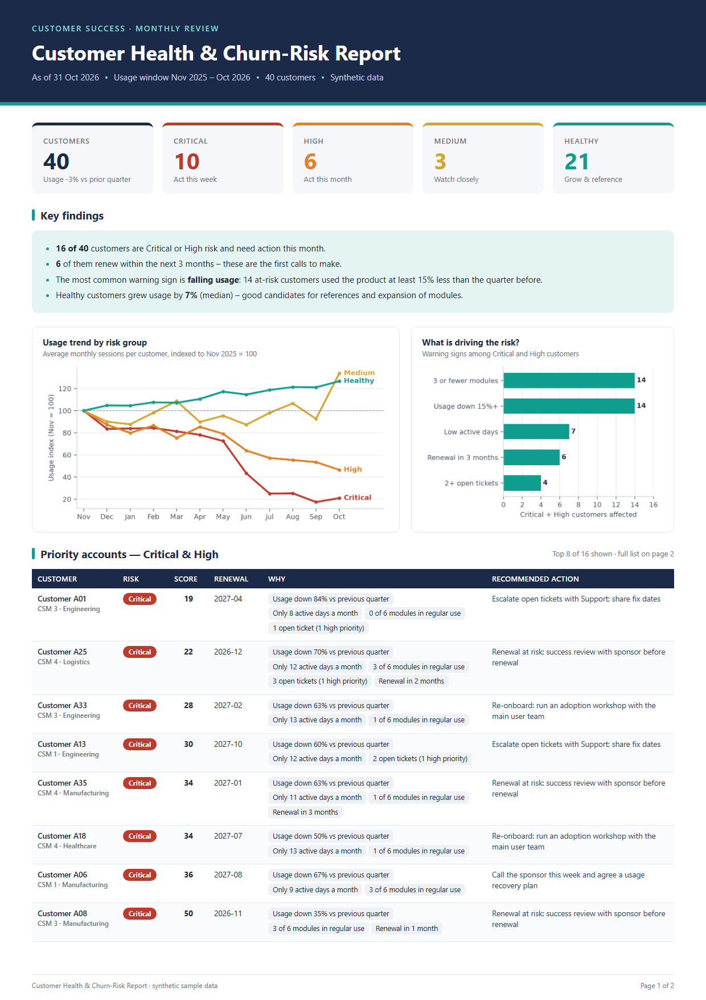

# Customer Health & Churn-Risk Analysis

**Spots which B2B software customers are likely to leave, explains why in plain words, and recommends the next action for each one.**



*Page 1 of the generated report. All customers and numbers are synthetic (made up for this project).*

---

## Problem

A customer success team looks after dozens of business customers. Usage data, support tickets and renewal dates sit in different places, so the team usually finds out a customer is unhappy **too late** - often close to renewal. They need one simple monthly view that answers:

- Which customers are at risk right now?
- **Why** is each one at risk?
- What should we do about it, and who do we call first?

## What I built

A small, repeatable analysis that turns raw activity data into a one-click management report:

1. **Data** - 12 months of product usage for 40 fictional customers across 6 product modules, plus support tickets and renewal months.
2. **Health score (0-100)** built from four easy-to-explain parts:

   | Part | Points | What it measures |
   |---|---|---|
   | Usage trend | 30 | Is usage growing or falling vs the previous quarter? |
   | Active days | 25 | How many days a month does the customer actually log in? |
   | Modules adopted | 25 | How many of the 6 modules are in regular use? |
   | Open tickets | 20 | Are there unresolved support issues (especially high priority)? |

3. **Risk bands with plain rules** - Critical (below 40), High (40-59), Medium (60-79), Healthy (80+). A renewal within 3 months moves an unhealthy customer up one level, so those calls happen first.
4. **"Why" + recommended action** for every customer, e.g. *"Usage down 63% vs previous quarter - 1 of 6 modules in regular use - Renewal in 3 months"* &rarr; *"Renewal at risk: success review with sponsor before renewal"*.
5. **Outputs** - a 2-page PDF report (summary cards, key findings, usage-trend chart, risk-driver chart, priority table, full customer list and scoring rules) and an Excel workbook for the team to filter and work from.

## Result

- **16 of 40** customers flagged as Critical or High risk, each with a clear reason and next step.
- **6** of them renew within 3 months - a ready-made call list for this week.
- Falling usage was the most common warning sign, showing up months before renewal - early enough to act.
- Healthy customers are listed too, as candidates for references and wider module adoption.
- The whole report rebuilds in seconds when new monthly data arrives, replacing manual spreadsheet work.

*Based on work in my current role; this version uses synthetic data.*

## Skills shown

- **Data analysis:** Python (pandas) - cleaning, joining and aggregating usage and ticket data
- **KPI design:** an explainable, rule-based health score that non-technical teams can trust
- **Reporting & MIS:** automated PDF/PNG management report (HTML + Jinja2 + headless Chrome)
- **Data visualisation:** matplotlib trend and driver charts
- **Excel:** formatted multi-sheet workbook with filters and colour-coded risk
- **Business thinking:** turning numbers into prioritised, actionable recommendations

## Files

| File | What it is |
|---|---|
| `output/customer_health_report.pdf` | The 2-page management report |
| `output/customer_health_report.png` | Page 1 as an image |
| `output/customer_health.xlsx` | Working file: summary, health scores, usage, tickets, scoring rules |
| `generate_sample_data.py` | Creates the synthetic data (fixed seed, so results repeat) |
| `analyse.py` | Scores customers and builds all outputs |
| `templates/report.html.j2` | Report layout |
| `data/` | Generated sample data (CSV) |

---

## How to run

Requires Python 3.10+ and Google Chrome (only for the PDF/PNG step; the HTML and Excel are created without it).

```bash
pip install -r requirements.txt
python generate_sample_data.py   # creates data/*.csv
python analyse.py                # creates everything in output/
```

To use your own data, replace the three CSV files in `data/` with the same column names.
